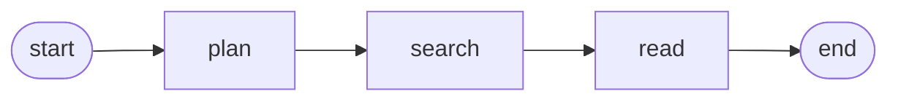

# ResearchPilot architecture

Owner: Rishabh (T30)

## Overview
## Research agent graph

Code: `app/agents/research/graph.py`. Built so far (outline approval, write, verify and compile follow):

| Node | Code | What it does |
|---|---|---|
| `plan` | `nodes/planner.py` (T06) | Topic to 3 to 6 sections, each with subtopics and up to 3 search queries |
| `search` | `nodes/sources.py` (T07) | Runs each section's queries (sections in parallel threads) and picks up to 8 candidate pages per section: the queries' results in turn, at most 2 per site, no social media |
| `read` | `nodes/sources.py` (T07), `tools/reader.py` (T08) | Reads every candidate web page or PDF once (8 at a time), skips unusable and paid pages, picks each section's most relevant passages, registers the pages that were read as `S1`, `S2`… and attaches every passage with its source ID |

On a real topic, `plan → search → read` takes about 30 to 40 seconds: 1 LLM call, up to 18 searches, about 30 pages
read, and 12 passages (about 10,000 characters) per section from 20 to 25 different sites.

The search and read steps use threads inside one node rather than one LangGraph branch per section, so a page that
several sections found is fetched once and the source IDs are handed out in one place. The writer (T12) is where
per-section branches pay off.

## State design

Code: `app/agents/research/state.py`.

| Key | Type | Reducer | Purpose |
|---|---|---|---|
| `topic` | str | replace | The user's topic |
| `section_order` | list of section IDs | replace | Outline order; the report has exactly these sections |
| `sections` | dict: section ID to `Section` | merge by ID, None removes | Each section with its own queries, passages, sources, draft, citations, status |
| `sources` | dict: source ID to `Source` | merge by ID | Source registry (`S1`, `S2`...): URL, title, domain |
| `outline_approved` | bool | replace | Set when the user approves the outline |
| `feedback` | list of `Feedback` | replace | Change requests with their kind and target sections |
| `sections_to_run` | list of section IDs | replace | Sections the next search, write and verify pass works on |
| `search_results` | dict: section ID to pages found | replace | Hand-over from search to read; the read step empties it |
| `report` | str | replace | Final Markdown with numbered citations and references |
| `metrics` | `RunMetrics` | sum | LLM calls, search calls, pages fetched, tokens |

A `Section` holds `id`, `title`, `subtopics`, `queries`, `passages` (each tied to a source ID), `source_ids`,
`draft` (with inline `[S#]` citations), `citations` (claim, source IDs, verifier result), `status`
(planned, researching, drafted, verified, needs_revision) and `revision`.

Why it looks like this:

- **Section-level editing.** Everything a section needs is inside the section, so a change request re-runs only the
  sections in `sections_to_run` and leaves the rest as they are.
- **Citations from the start.** A passage is stored with its source ID when the page is read. The writer only sees
  passages with IDs, so every claim it writes can point at a source, and the verifier can check that source.
- **Parallel sections.** Sections are researched in parallel branches. The merge-by-ID reducer lets each branch
  return only its own section, and the metrics reducer adds up the counts from all branches.
- **Checkpoint-safe.** The state is plain dicts and lists, so the SQLite checkpointer saves and restores it for the
  outline approval pause without any custom serialisation. Pydantic is used only for LLM structured output.
- **Source IDs are assigned in one sequential step**, never in parallel branches, so two sections cannot hand out
  the same ID.
- **One place for ID and citation formats.** `next_section_id()` and `next_source_id()` hand out the next ID after
  the highest one in use. Sources are never removed, so a source ID always means the same page. `cited_source_ids()`
  reads `[S1]`, `[S1][S2]` and `[S1, S2]` marks, and the writer, compiler, verifier and evaluation all use it.
- **Metric typos fail loudly.** The metrics reducer rejects unknown names, so `{"llm_call": 1}` raises instead of
  going missing from the totals.

How change requests map onto the state:

| Request | `Feedback` | What re-runs |
|---|---|---|
| "Make section 3 more detailed" | `expand_section`, `section_ids=["sec-3"]` | Search, write and verify for sec-3 |
| "Add a subtopic on government policy" | `add_subtopic`, `section_ids=[]` | A new section (`next_section_id()`) is added to `section_order` and researched |
| "Add battery costs to section 2" | `add_subtopic`, `section_ids=["sec-2"]` | sec-2 gets the subtopic and is re-run |
| "Replace the weak sources in section 2" | `replace_sources`, `section_ids=["sec-2"]` | Sources that no supported citation uses are dropped from sec-2, then it is re-searched |

In every case only the listed sections are put in `sections_to_run`, and `revision` goes up by one for each.

## Human-in-the-loop and checkpointing
## Analysis agent (and why it is a separate graph)
## Knowledge base and chatbot
## Key decisions and trade-offs

- **Swappable LLM providers** (`app/llm/provider.py`). Groq or Gemini is chosen by `LLM_PROVIDER`. When both have
  keys, the other one is a fallback: each provider retries on its own first (rate limits, timeouts), then the call
  moves to the other. Free tiers have rate limits, so this keeps long research runs going. Each fallback is logged
  with the reason, because a silent fallback hides a broken provider.
- **Structured output on Groq uses `json_schema`, not tool calling.** With gpt-oss models, LangChain's default (tool
  calling) failed on 9 of 9 short prompts: the model answered in prose instead of calling the tool, and every call
  quietly went to the Gemini fallback. `json_schema` (constrained decoding) succeeded on 9 of 9. Live tests
  (`uv run pytest -m live`) test each provider alone, without the fallback, to catch this kind of failure.
- **Token and call counts per node** (`app/llm/usage.py`). Structured output returns only the parsed object, so the
  token usage is lost. `track_usage()` collects it from LangChain callbacks instead and returns it in the
  `RunMetrics` shape.
- **Traces tagged by version** (`app/observability.py`). Every run carries module, `RUN_VERSION` and topic tags, so
  v1 and v2 runs can be compared side by side in LangSmith.
- **Search: ddgs first, Tavily as fallback, results cached** (`app/tools/search.py`). Free engines push back on
  automated traffic: DuckDuckGo alone returned nothing (HTTP 202), others answered 403 or timed out, and a ddgs
  query took 10 to 50 seconds. With a fallback, ddgs gets one attempt and Tavily (about 3 seconds per query) takes
  over. Results are cached on disk, so the v1 and v2 evaluation runs see the same sources; that keeps the comparison
  fair and saves rate limits.
- **The planner keeps its own knowledge out of the search queries** (`nodes/planner.py`). In testing, the LLM's
  queries named products and schemes that no longer exist or never did, and asked for "2023" and "2024" data in late
  2026. The prompt now asks for general terms and no years, and code removes any year left in a query, so the search
  finds the current facts. Limits (3 to 6 sections, at most 3 queries each) are applied in code, not in the JSON
  schema, because Groq's strict mode can reject schema limits; this caps a report at 18 web searches.
- **A page gets a source ID only after it has been read** (`nodes/sources.py`). Every source in the registry
  therefore exists and was read, and every passage the writer sees carries the ID of the page it came from, which
  is the brief's "no citation, no claim" and "do not fabricate sources" built into the data.
- **One article, one source.** Pages are matched by URL and by text, so copies of an article on two sites count once.
  In testing, finance.yahoo.com and uk.finance.yahoo.com carried the same article with one word different
  ("inquiries" / "enquiries"), so texts match when 80% of their 5-word sequences overlap.
- **Weak sources are filtered before they can be cited.** Social media and forums, the search provider's own pages
  (Tavily once returned its company-database page for an unrelated UK firm named "Q Commerce"), paid press releases,
  paywalled pages with under 500 characters of text, and blocked pages are skipped.
- **Passages are picked with BM25 keyword scoring** against each section's title, subtopics and queries: no model
  download, fast, and the same result every time. Embeddings (already used by the knowledge base) could replace it
  if passage quality turns out to limit the writer.
- **The reader reads PDFs too** (`tools/reader.py`, pypdf). On 153 real search results, PDFs were half of the
  pages it could not read, and often the best sources (IIM Ahmedabad and IIM Bangalore research papers, law journals).
  With PDF support, 88% of pages are read instead of 73%. PDF lines are joined into paragraphs, because pypdf breaks
  every printed line, in one paper after every word.
- **Pages are cached like search results** (`data/page_cache`), so the v1 and v2 runs read exactly the same text.
  Pages that can never be used (404, blocked, too short) are cached as skipped; temporary failures (timeouts, 429,
  5xx) are retried next time. A cached skip is retried when the reader improves or its User-Agent changes.
- **Sites that block us are respected.** A 403 or 429 means skip the page, never work around it. With
  `READER_CONTACT` set, the reader names the project and a contact in its User-Agent; Wikipedia requires this and
  answers 403 otherwise. Without it the reader uses a common browser User-Agent and Wikipedia pages are skipped.
